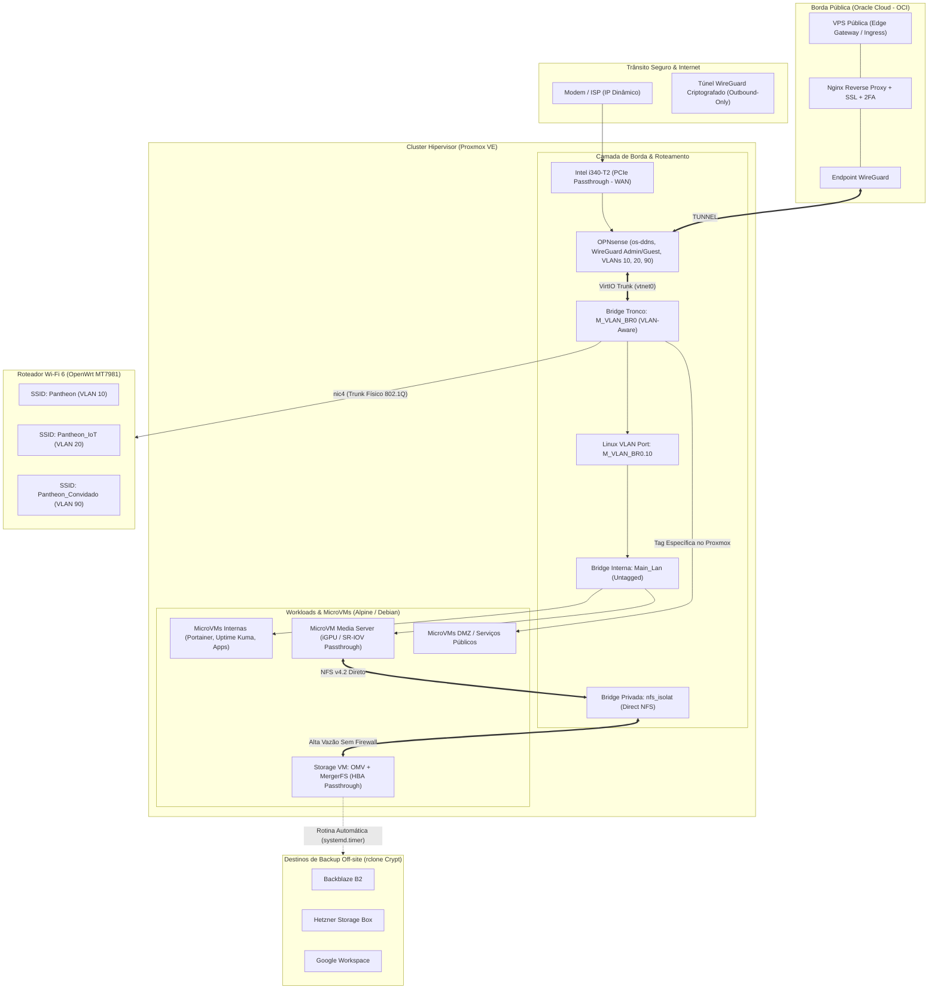

# DevOps & Infrastructure Engineering Portfolio

> **Repositório de documentação arquitetural, automações de infraestrutura e padrões de conteinerização de um ambiente de alta resiliência e nuvem híbrida.**

[](https://github.com/placeholder-user/devops-portfolio/actions)


---

## 🎯 Sobre Mim

Estudante de **Engenharia de Computação** com sólida vivência prática em administração de sistemas Linux, arquitetura de redes virtuais e físicas, conteinerização com Docker e gestão de armazenamento resiliente.

Este repositório documenta a infraestrutura que projetei e mantenho ativamente, servindo como demonstração das minhas competências práticas em:
- **Administração Linux Avançada**: Diagnóstico de kernel/serviços (`journalctl`, `dmesg`, `ss`), automações via `systemd` (units, timers, automounts) e distribuição enxuta em microVMs Alpine.
- **Engenharia de Redes & Segurança**: Virtualização de firewalls perimetrais (OPNsense com PCIe Passthrough de NIC), segmentação L2/L3 com bridges Linux e VLANs 802.1Q, VPNs WireGuard e roteamento com OpenWrt.
- **Conteinerização & Orquestração**: Docker Compose estruturado com limites de CPU/RAM, verificações de saúde (`healthchecks`), isolamento de redes de contêineres e aceleração de hardware via passthrough de GPU (SR-IOV / Intel QuickSync).
- **Armazenamento e Política de Backup 3-2-1**: Pooling de dados com MergerFS, pontes NFS/SMB isoladas, sincronização entre nós (Syncthing) e backups criptografados com `rclone` para múltiplos provedores de nuvem (Backblaze B2, Hetzner, Google Drive).
- **Esteiras de Integração Contínua (CI/CD)**: Automação via GitHub Actions para validação sintática de stacks Compose, linters de shell (`shellcheck`) e garantia de conformidade de infraestrutura.

---

## 🏛️ Visão Geral da Arquitetura

O ambiente opera como uma nuvem híbrida conectando um cluster local de virtualização sobre **Proxmox VE** a nós de borda na **Oracle Cloud Infrastructure (OCI)**.



---

## 📂 Estrutura do Repositório

```text
.
├── .github/
│   └── workflows/
│       └── ci.yml                     # Pipeline CI/CD: Validação de compose, shellcheck e units
├── architecture/
│   ├── network-topology.md            # Topologia de rede L2/L3, VLANs, bridges e OPNsense
│   ├── storage-and-backup.md          # Arquitetura MergerFS, NFS seguro e política de backup 3-2-1
│   └── security-and-ingress.md        # Ingress seguro via Oracle Cloud, zero port-forwarding e 2FA
├── compose-stacks/
│   ├── monitoring/
│   │   └── docker-compose.yml         # Stack de observabilidade Uptime Kuma com healthcheck nativo
│   ├── ingress-proxy/
│   │   ├── docker-compose.yml         # Nginx edge proxy com isolamento e limites de recursos
│   │   └── nginx.conf                 # Configuração de segurança HTTP, headers e healthz
│   └── media-acceleration/
│       └── docker-compose.yml         # Stack com passthrough de GPU (/dev/dri) e montagem NFS
└── automation/
    ├── scripts/
    │   └── backup-rclone.sh           # Script de backup incremental com logs, retries e rclone crypt
    └── systemd/
        ├── rclone-backup.service      # Service unit do systemd para execução do script
        ├── rclone-backup.timer        # Timer unit para agendamento resiliente diário
        ├── mnt-storage-media.mount    # Montagem resiliente de sistema de arquivos NFS via systemd
        └── mnt-storage-media.automount# Automount sob demanda com timeout de inatividade
```

---

## 🛠️ Detalhamento dos Pilares Técnicos

### 1. Administração de Ambientes Linux
- **Distribuições Enxutas**: Utilização extensiva de **Alpine Linux** para microVMs dedicadas a serviços específicos, resultando em menor superfície de ataque, boot quase instantâneo e uso mínimo de memória RAM (< 128 MB por nó).
- **Automação Nativa com systemd**: Substituição de entradas frágeis de montagem e cron por `.mount`, `.automount` e `.timer` units. Assegura que montagens remotas dependam de `network-online.target` e sejam reconectadas sob demanda com timeouts controlados.
- **Diagnóstico & Troubleshooting**: Utilização rotineira de `journalctl` com filtros de prioridade, `dmesg` para detecção de anomalias de hardware/IOMMU, `ss` e ferramentas do pacote `iproute2` para inspeção de sockets e tabelas de roteamento.

### 2. Conteinerização com Docker & Orquestração
- **Padronização de Compose**: Todos os contêineres possuem:
  - Diretivas `healthcheck` para checagem ativa de integridade da aplicação.
  - `no-new-privileges: true` para proteção contra elevação indevida de privilégios de kernel.
  - Alocação e reserva de recursos explícitas (`cpus` e `memory`) prevenindo que um serviço consuma a totalidade dos nós.
- **Portainer Centralizado**: Utilização de agentes leves em cada microVM controlados por um nó mestre do Portainer, possibilitando governança centralizada sem sobrecarregar nós periféricos.
- **Aceleração por Hardware em Contêineres**: Mapeamento seguro de nós de dispositivo (`/dev/dri/renderD128`) para permitir transcodificação acelerada por hardware de vídeo via Intel QuickSync.

### 3. Redes, Isolamento & Nuvem Híbrida
- **OPNsense Virtualizado com Passthrough**: Placa de rede física dedicada passada via IOMMU para o firewall virtual, tornando o OPNsense a primeira barreira de defesa diretamente ligada ao modem.
- **VLANs em Bridges Linux**: Uso de uma bridge trunk no Proxmox e bridges downstream associadas a portas de acesso para segregar completamente tráfego de gestão, cargas internas, convidados e dispositivos IoT.
- **Ingress Zero-Port-Forwarding**: Serviços internos acessíveis externamente não abrem portas no roteador doméstico. O tráfego entra através de uma VPS pública na Oracle Cloud e é transportado via túnel WireGuard de saída persistente.

### 4. Observabilidade & Monitoramento Pragmático
- **Uptime Kuma**: Monitoramento contínuo de disponibilidade HTTP(s), latência de DNS e portas TCP, integrado a notificações automáticas por e-mail e webhook quando qualquer serviço excede limites de tolerância.
- **Monitoramento de Saúde de Hardware**: Alertas automáticos no OpenMediaVault configurados para monitorar atributos S.M.A.R.T. dos discos físicos e temperatura do sistema.
- **Auditoria de Tráfego**: Logs de conexão e bloqueios no firewall OPNsense inspecionados para identificar varreduras e tentativas anômalas de conexão.

### 5. Integração Contínua (CI/CD)
- **Pipeline Automatizada (GitHub Actions)**:
  - Validação sintática e de interpolação de todas as stacks Docker Compose com `docker compose config`.
  - Análise estática de código dos scripts Bash com `shellcheck`.
  - Validação de declarações e sintaxe das units do `systemd`.

---

## 🚀 Como Executar e Validar Localmente

### Pré-requisitos
- Docker & Docker Compose (`docker compose version >= 2.20`)
- ShellCheck (`apt install shellcheck` ou equivalente)

### Validando as Stacks de Contêineres
```bash
# Validar sintaxe da stack de monitoramento
docker compose -f compose-stacks/monitoring/docker-compose.yml config

# Validar sintaxe da stack de ingress
docker compose -f compose-stacks/ingress-proxy/docker-compose.yml config
```

### Validando os Scripts de Automação
```bash
# Executar análise estática de conformidade no script de backup
shellcheck automation/scripts/backup-rclone.sh
```

---

## 📜 Licença
Distribuído sob licença MIT. Consulte o arquivo [LICENSE](LICENSE) para maiores informações.
