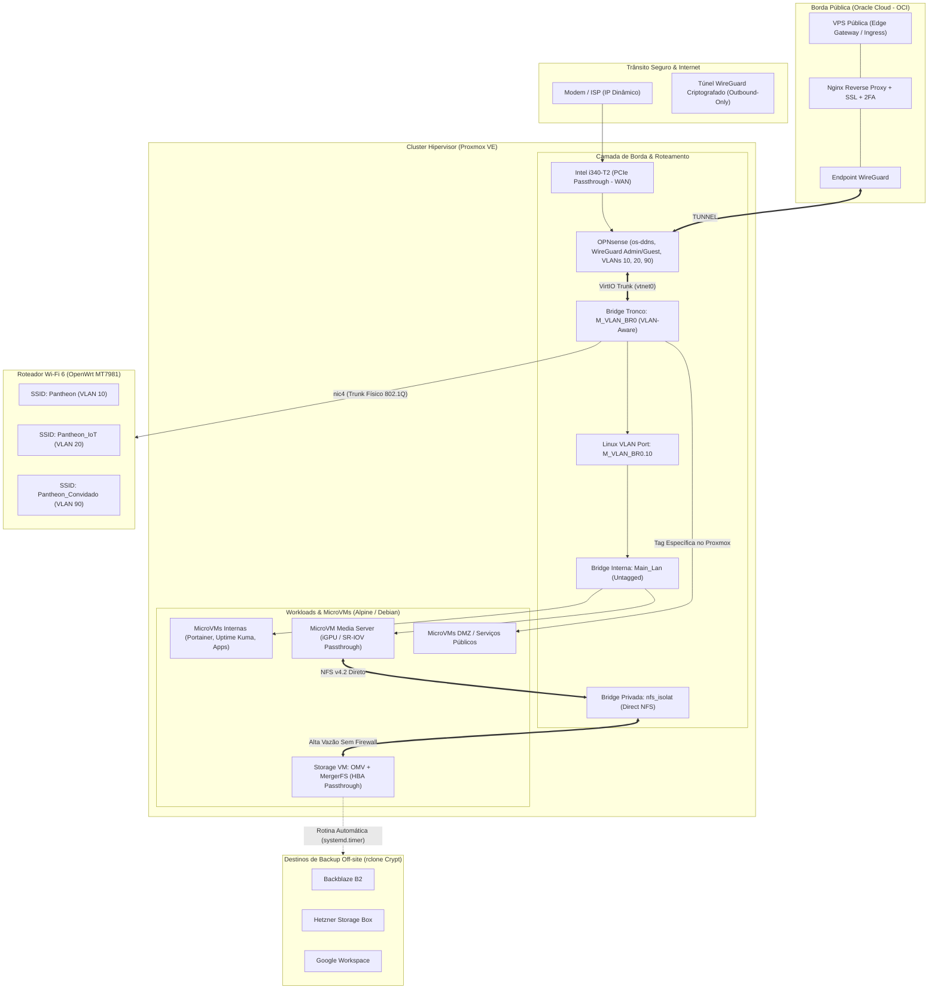
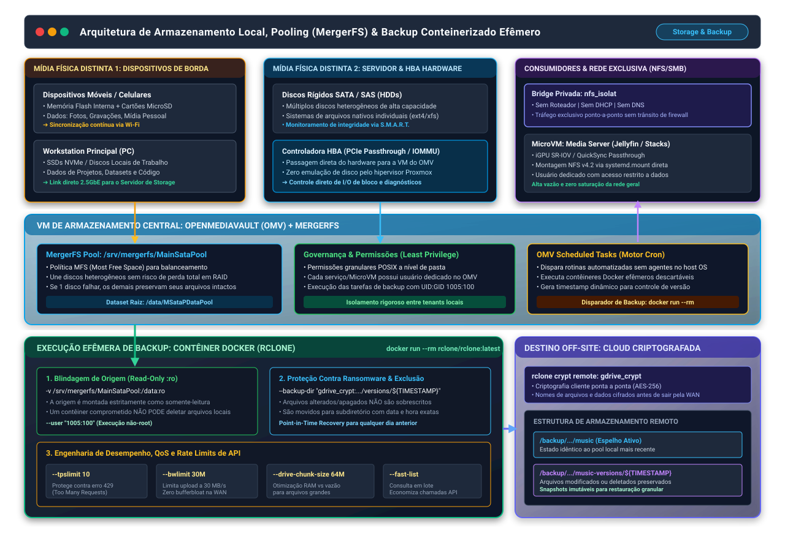

# DevOps & Infrastructure Engineering Portfolio

> **Repositório de documentação arquitetural, automações de infraestrutura e padrões de conteinerização de um ambiente de alta resiliência e nuvem híbrida.**

[](https://github.com/placeholder-user/devops-portfolio/actions)


---

## 🎯 Sobre Mim

Estudante de **Engenharia de Computação** com sólida vivência prática em administração de sistemas Linux, arquitetura de redes virtuais e físicas, conteinerização com Docker e gestão de armazenamento resiliente.

Este repositório documenta a infraestrutura que projetei e mantenho ativamente, servindo como demonstração das minhas competências práticas em:
- **Administração Linux Avançada**: Diagnóstico de kernel/serviços (`journalctl`, `dmesg`, `ss`), automações via `systemd` (units, timers, automounts) e distribuição enxuta em microVMs Alpine.
- **Engenharia de Redes & Segurança**: Virtualização de firewalls perimetrais (OPNsense com PCIe Passthrough de NIC), segmentação L2/L3 com bridges Linux e VLANs 802.1Q, VPNs WireGuard e roteamento com OpenWrt.
- **Conteinerização & Orquestração**: Docker Compose estruturado com limites de CPU/RAM, verificações de saúde (`healthchecks`), isolamento de redes de contêineres e aceleração de hardware via passthrough de GPU (SR-IOV / Intel QuickSync).
- **Armazenamento e Política de Backup 3-2-1**: Pooling de dados com MergerFS, pontes NFS/SMB isoladas, sincronização entre nós (Syncthing) e backups criptografados com `rclone` para múltiplos provedores de nuvem (Backblaze B2, Hetzner, Google Drive).
- **Esteiras de Integração Contínua (CI/CD)**: Automação via GitHub Actions para validação sintática de stacks Compose, linters de shell (`shellcheck`) e garantia de conformidade de infraestrutura.

---

## 🏛️ Visão Geral da Arquitetura

O ambiente opera como uma nuvem híbrida conectando um cluster local de virtualização sobre **Proxmox VE** a nós de borda na **Oracle Cloud Infrastructure (OCI)**.


### Fluxo de Conexão e Zonas Lógicas


---

## 📂 Estrutura do Repositório

```text
.
├── .github/
│   └── workflows/
│       └── ci.yml                     # Pipeline CI/CD: Validação de compose, shellcheck e units
├── architecture/
│   ├── network-topology.md            # Topologia de rede L2/L3, VLANs, bridges e OPNsense
│   ├── storage-and-backup.md          # Arquitetura MergerFS, NFS seguro e política de backup 3-2-1
│   └── security-and-ingress.md        # Ingress seguro via Oracle Cloud, zero port-forwarding e 2FA
├── compose-stacks/
│   ├── agora-community/
│   │   ├── thelounge/docker-compose.yml       # Stack TheLounge (memory cap 384M no Alpine)
│   │   └── uptime-kuma/docker-compose.yml     # Stack Uptime Kuma 2 (healthcheck curl & rotação de logs)
│   ├── homer-media/
│   │   ├── jellyfin-navidrome/docker-compose.yml # Stack Streaming (Intel QuickSync VAAPI /renderD128)
│   │   └── plex/docker-compose.yml            # Stack Plex (network_mode: host + SQLite em Intel Optane)
│   ├── prometheus-downloader/
│   │   ├── jdownloader/docker-compose.yml     # Stack JDownloader-2 (WebUI porta 5800)
│   │   └── tautulli/docker-compose.yml        # Stack Tautulli (telemetria e auditoria Plex)
│   ├── arcadia-gameserver/
│   │   ├── crafty/docker-compose.yml          # Stack Crafty Controller 4 (Minecraft Java/Bedrock/Dynmap)
│   │   └── syncthing/docker-compose.yml       # Stack Syncthing (sincronização de backups de mundos)
│   ├── syncthing-node/
│   │   └── docker-compose.yml                 # Blueprint do agente Syncthing distribuído por MicroVM
│   └── ingress-proxy/
│       ├── docker-compose.yml                 # Stack Nginx Edge Proxy (Oracle Cloud)
│       └── nginx.conf                         # Configuração Nginx com SSL e headers de segurança
└── automation/
    ├── scripts/
    │   ├── omv-docker-rclone-backup.sh# Blueprint de container efêmero Docker no OMV com Least Privilege
    │   ├── oracle-vps-backup-rotate.sh# Script de retenção multi-tier e expurgo numérico na Oracle Cloud
    │   └── backup-rclone.sh           # Script de backup incremental com logs e rclone crypt
    ├── crontab/
    │   └── crontab-oracle-vps.cron    # Agendamento no Linux com prioridades de kernel nice e ionice
    └── systemd/
        ├── rclone-backup.service      # Service unit do systemd para execução de backups locais
        ├── rclone-backup.timer        # Timer unit para agendamento resiliente diário
        ├── mnt-storage-media.mount    # Montagem resiliente de sistema de arquivos NFS via systemd
        └── mnt-storage-media.automount# Automount sob demanda com timeout de inatividade
```

---

## 🛠️ Detalhamento dos Pilares Técnicos

### 1. Administração de Ambientes Linux & Concorrência
- **Distribuições Enxutas**: Utilização extensiva de **Alpine Linux** para microVMs dedicadas a serviços específicos, resultando em menor superfície de ataque, boot quase instantâneo e uso mínimo de memória RAM (< 128 MB por nó).
- **Controle de Concorrência de I/O e CPU**: Aplicação de diretivas avançadas de kernel no Linux (`nice -n 19` e `ionice -c 3`) em tarefas agendadas na Oracle Cloud VPS. Isso garante que rotinas pesadas de compactação e envio de dados para nuvem operem exclusivamente em modo ocioso, sem impactar o desempenho do servidor de jogos.
- **Automação com systemd & Cron**: Substituição de montagens frágeis por `.mount` e `.automount` com dependência estrita de rede.

### 2. Armazenamento Resiliente & Estratégia de Backup 3-2-1



- **Mídias Físicas Distintas & Sincronização**: Sincronização contínua de dados essenciais entre dispositivos móveis (memórias flash / cartões SD), workstations (SSDs) e o cluster de armazenamento primário (HDDs mecânicos em pool MergerFS via controladora HBA dedicada).
- **Backups via Contêineres Efêmeros (OMV)**: Execução de tarefas rclone encapsuladas em contêineres Docker descartáveis (`docker run --rm`), operando sob usuário não-root restrito (`--user 1005:100`) e com montagem estritamente somente-leitura (`:ro`), tornando impossível a corrupção da origem.
- **Point-in-Time Recovery & Ransomware Defense**: Uso de `--backup-dir` com pastas versionadas dinâmicas. Arquivos alterados ou deletados na origem não são sobrescritos destrutivamente, permitindo restauração de estados históricos em caso de incidente.
- **Retenção Multi-Tier na Oracle Cloud**: Ciclo de vida de backups com retenção horária (3h), diária, semanal e mensal para o Backblaze B2, com expurgo automático via análise de timestamps remotos.

### 3. Conteinerização com Docker, MicroVMs & Alta Performance
- **MicroVM Workloads Temáticas**: Cada domínio de aplicação opera isolado em sua própria MicroVM (Alpine/Debian):
  - `Agora-CommunityHost`: Aplicações de comunidade e observabilidade (TheLounge + Uptime Kuma 2).
  - `Homer-Media_server`: Streaming acelerado por hardware e servidor de áudio (Jellyfin + Navidrome + Plex).
  - `Prometheus_downloader`: Ingestão remota de dados e telemetria (JDownloader-2 + Tautulli).
  - `Arcadia_GameServer`: Gestão multi-porta de servidores de jogos (Crafty Controller 4).
  - `Syncthing Node Blueprint`: Agente de replicação contínua descentralizada rodando em cada MicroVM.
- **Engenharia de Memória & Footprint**: Otimização estrita de runtime em aplicações NodeJS (como TheLounge com `--max-old-space-size=512` e `deploy.resources.limits.memory: 384M`), assegurando execução estável e previsível dentro de microVMs Alpine enxutas.
- **Aceleração por Hardware & GPU Passthrough**: Mapeamento direto de nós de renderização `/dev/dri/renderD128` com grupo `991` para transcodificação de vídeo em tempo real (Intel QuickSync / VAAPI) no Jellyfin.
- **Camada de Injeção de Ultra Baixa Latência (Intel Optane)**: Montagem dedicada de disco Intel Optane de 8GB (`/mnt/optane_db/plex/Databases`) para operações atômicas de leitura/escrita do banco de dados SQLite do Plex, eliminando gargalos de metadados durante varreduras massivas de biblioteca.
- **Portainer Centralizado**: Governança e monitoramento de ciclos de vida dos contêineres distribuídos através de agentes leves conectados ao console mestre.

### 4. Redes, Isolamento & Nuvem Híbrida
- **OPNsense Virtualizado com Passthrough**: NIC física Intel i340 dedicada diretamente ligada ao modem via IOMMU.
- **VLANs em Bridges Linux**: Bridge tronco `M_VLAN_BR0` e sub-redes dedicadas (VLAN 10 Main, VLAN 20 IoT, VLAN 90 Guest), integradas via trunk 802.1Q a roteador OpenWrt com Wi-Fi 6.
- **Ingress Zero-Port-Forwarding**: Serviços internos expostos externamente através de uma VPS pública na Oracle Cloud conectada por túnel WireGuard de saída persistente.

### 5. Observabilidade & Monitoramento Pragmático (Event-Driven Alerting)
- **Uptime Kuma & Resolução de Endpoints**: Monitoramento ativo de disponibilidade de aplicações HTTP(s), latência de resolução DNS e portas TCP críticas, despachando alertas automáticos por e-mail e webhook em caso de indisponibilidade prolongada.
- **Saúde Física de Discos (S.M.A.R.T. via smartd)**: Varredura proativa de setores realocados, setores pendentes e variações térmicas dos discos mecânicos e SSDs no OMV, com disparo de alerta imediato por e-mail contendo número de série do dispositivo afetado.
- **Status de Finalização de Scripts & Automação**: Captura de códigos de retorno (`exit status`) e saída de erro de rotinas agendadas (OMV Scheduled Tasks e cron na VPS), enviando relatórios resumidos de conclusão e e-mails de emergência em falhas operacionais.
- **Resource Management Proativo**: Thresholds de capacidade no OMV notificando o administrador por e-mail quando a ocupação do pool MergerFS ultrapassa 80% (preventivo) e 90% (crítico), bem como alertas para saturação de memória ou anomalias de I/O.
- **Auditoria de Tráfego Perimetral**: Análise sob demanda dos logs de inspeção e regras de firewall no OPNsense para identificar varreduras e tentativas anômalas de conexão.

### 6. Integração Contínua (CI/CD)
- **Pipeline Automatizada (GitHub Actions)**:
  - Validação sintática e de interpolação de todas as stacks Docker Compose com `docker compose config`.
  - Análise estática de código dos scripts Bash com `shellcheck`.
  - Validação de declarações e sintaxe das units do `systemd`.

---

## 🚀 Como Executar e Validar Localmente

### Pré-requisitos
- Docker & Docker Compose (`docker compose version >= 2.20`)
- ShellCheck (`apt install shellcheck` ou equivalente)

### Validando as Stacks de Contêineres
```bash
# Validar sintaxe da stack de monitoramento
docker compose -f compose-stacks/monitoring/docker-compose.yml config

# Validar sintaxe da stack de ingress
docker compose -f compose-stacks/ingress-proxy/docker-compose.yml config
```

### Validando os Scripts de Automação
```bash
# Executar análise estática de conformidade no script de backup
shellcheck automation/scripts/backup-rclone.sh
```

---

## 📜 Licença
Distribuído sob licença MIT. Consulte o arquivo [LICENSE](LICENSE) para maiores informações.
