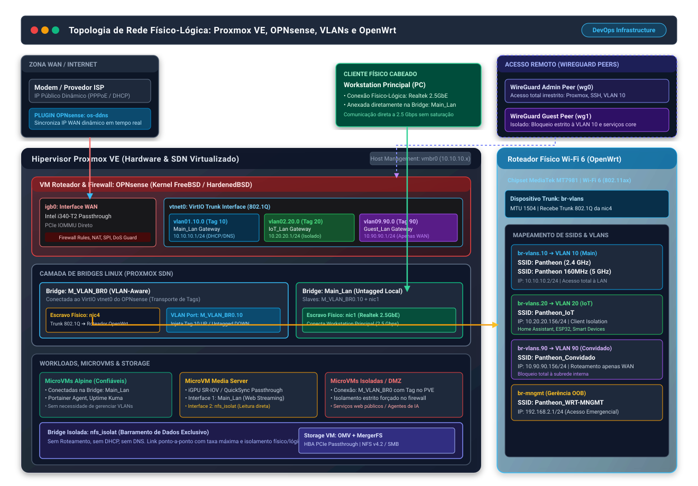
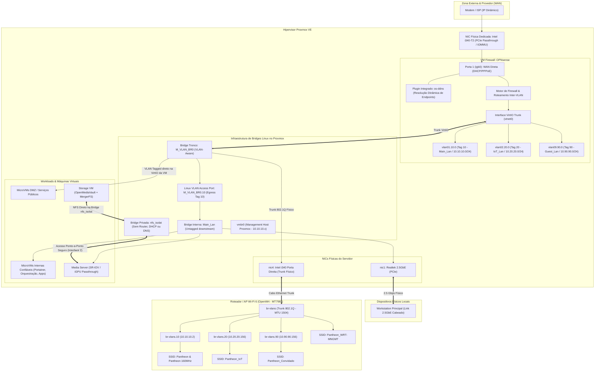
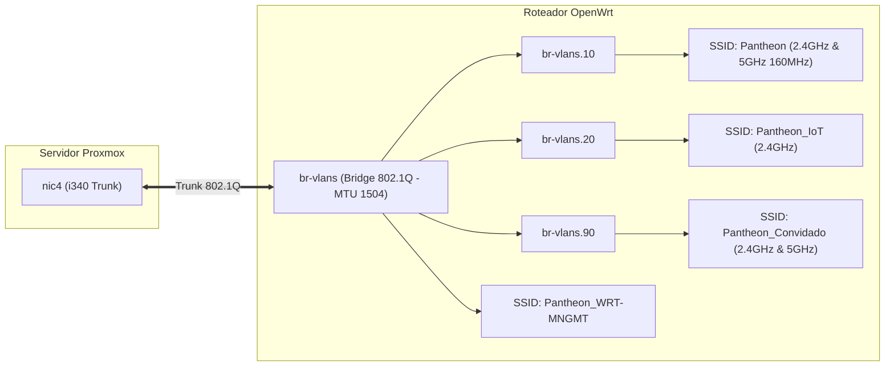

# Arquitetura de Rede, Topologia L2/L3 e Virtualização

Este documento apresenta a especificação técnica e visual da infraestrutura de rede, detalhando a segmentação lógica sobre o hipervisor Proxmox VE, o firewall virtualizado OPNsense, o roteamento externo via OpenWrt e o controle de acesso via WireGuard.

---

## 1. Topologia Geral & Conectividade Física/Lógica

Toda a arquitetura é projetada para priorizar a **definição lógica de rede sobre a dependência física**, garantindo flexibilidade, isolamento rigoroso de zonas e segurança perimetral centralizada.



### Diagrama de Relações e Fluxos Lógicos


---

## 2. Detalhamento da Camada de Virtualização de Rede (Proxmox VE)

A configuração no Proxmox elimina a complexidade de configurar tags 802.1Q dentro do sistema operacional de cada máquina virtual cliente:

```
[ M_VLAN_BR0 (VLAN-Aware Bridge) ]
       │
       ├─── nic4 (Intel i340 physical port) ──> Cabo Trunk 802.1Q para o OpenWrt
       ├─── vtnet0 (VirtIO NIC da VM OPNsense) ──> Trunk para o Firewall
       │
       └─── M_VLAN_BR0.10 (Linux VLAN Access Port)
                 │  (Injeta tag 10 ao subir / remove tag 10 ao descer)
                 ▼
       [ Main_Lan (Linux Bridge) ]
            ├─── nic1 (Realtek 2.5GbE) ──> PC Principal do Usuário
            ├─── MicroVMs Confiáveis (Alpine/Debian com VirtIO simples)
            ├─── Servidor de Mídia (Jellyfin/Plex - streaming web na Main_Lan)
            └─── Containers / Portainer Workloads
```

### Por que essa arquitetura é diferenciada?
1. **Transparência para Cargas de Trabalho**: As MicroVMs, o servidor de mídia e o PC principal conectam-se à bridge `Main_Lan` sem necessidade de suporte ou configuração de VLAN no sistema operacional convidado.
2. **Políticas Forçadas no Firewall**: Qualquer pacote que precise sair da sub-rede local precisa atravessar a porta de acesso `M_VLAN_BR0.10`. Nesse momento, o Linux aplica a tag `VLAN 10` e encaminha o pacote via `M_VLAN_BR0` até a interface `vlan01.10.0` no OPNsense, onde é inspecionado, roteado ou bloqueado.
3. **Isolamento de Cargas de Risco / DMZ**: Para serviços web públicos ou agentes autônomos que demandam isolamento estrito, a interface virtual da VM é conectada diretamente à bridge `M_VLAN_BR0` com a tag de VLAN configurada no próprio Proxmox (VLAN access port por VM). Assim, o tráfego da VM nunca toca na `Main_Lan` sem antes passar pelas regras de filtragem do OPNsense.
4. **Isolamento Total do Barramento de Armazenamento (`nfs_isolat`)**: A bridge `nfs_isolat` é totalmente desconectada do firewall, não possui IP de gateway, DHCP ou DNS. Apenas a VM do OpenMediaVault e os nós autorizados (como a VM do servidor de mídia, que possui interface secundária dedicada a essa rede privada) possuem interfaces anexadas a essa bridge, garantindo zero exposição pública de armazenamento e máxima taxa de transferência.

---

## 3. Segmentação de VLANs e Zonas de Segurança

Conforme parametrizado no OPNsense e OpenWrt:

| Identificador | VLAN ID | Sub-rede IPv4 | Interface OPNsense | Interface OpenWrt | Função & Política de Acesso |
| :--- | :---: | :--- | :--- | :--- | :--- |
| **Main_Lan** | `10` | `10.10.10.0/24` | `vlan01.10.0` | `br-vlans.10` | Rede principal confiável. Acesso total a serviços internos, internet e gerência administrativa. |
| **IoT_Lan** | `20` | `10.20.20.0/24` | `vlan02.20.0` | `br-vlans.20` | Dispositivos inteligentes (Home Assistant, ESP32, smart devices). Isolados da rede principal; sem acesso à `Main_Lan`. |
| **Guest_Lan** | `90` | `10.90.90.0/24` | `vlan09.90.0` | `br-vlans.90` | Rede para convidados e visitantes. Acesso exclusivo à internet; bloqueio total contra recursos privados. |
| **Storage_Net**| N/A | Sub-rede dedicada | *Desconectado* | *Desconectado* | Bridge `nfs_isolat` no Proxmox. Compartilhamento NFS ponto-a-ponto de alta vazão sem trânsito de firewall. |

---

## 4. Roteamento Físico e Ponto de Acesso Wi-Fi 6 (OpenWrt)

A infraestrutura física externa utiliza um roteador com firmware **OpenWrt** equipado com chipset **MediaTek MT7981** (Wi-Fi 6 802.11ax), conectado via cabo Ethernet diretamente à porta `nic4` (Intel i340) do servidor Proxmox:



- **Mapeamento de SSIDs**: Cada rede sem fio é mapeada diretamente para a respectiva sub-interface de VLAN do OpenWrt, garantindo que celulares de visitantes ou lâmpadas inteligentes caiam automaticamente na sua zona de isolamento sem intervenção manual.
- **Rede de Gestão OpenWrt**: Uma interface dedicada (`br-mngmt` / `192.168.2.1/24`) e um SSID reservado (`Pantheon_WRT-MNGMT`) garantem acesso seguro à gerência do roteador caso ocorra qualquer indisponibilidade no trunk principal.
