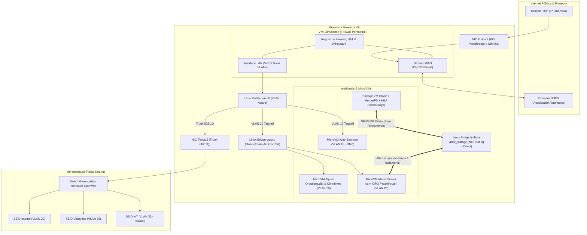

# Arquitetura de Rede e Segmentação L2/L3

Este documento detalha o modelo de conectividade, virtualização de rede e segurança perimetral implementado no ambiente de infraestrutura.

---

## 1. Topologia de Rede & Virtualização

---

## 2. Segmentação de VLANs e Políticas de Controle

A rede é particionada em zonas de confiança estritas controladas centralmente pelo firewall virtualizado OPNsense:

| VLAN ID | Nome da Zona | Finalidade | Política de Encaminhamento |
| :--- | :--- | :--- | :--- |
| **VLAN 10** | `DMZ_PUBLIC` | Serviços destinados à publicação externa | Bloqueio padrão para qualquer tráfego interno (VLAN 20/40); acesso restrito à WAN. |
| **VLAN 20** | `INTERNAL_WORKLOADS` | MicroVMs Alpine, Portainer, Game Servers, Media Stacks | Comunicação interna permitida; acesso à internet filtrado por DNS seguro e firewall. |
| **VLAN 30** | `GUEST_IOT` | Dispositivos inteligentes (Home Assistant/ESP32) e visitantes | Isolamento L2 entre clientes (*client isolation*); bloqueio total de tráfego para a VLAN 20. |
| **Isolada** | `STORAGE_BRIDGE` | Barramento de dados dedicado NFS/SMB | Bridge Linux sem gateway, sem DHCP e sem DNS. Acesso direto ponto-a-ponto entre nós consumidores e a VM de armazenamento. |

---

## 3. Acesso Remoto e VPNs (WireGuard & Gluetun)

- **WireGuard Centralizado no OPNsense**: Fornece túnel seguro para endpoints autorizados fora da residência com resolução garantida via cliente DDNS integrado no firewall.
- **Split Tunneling Rigoroso**: Dispositivos móveis e clientes remotos roteiam apenas tráfego com destino às subredes internas (`192.168.x.0/24`), evitando sobrecarga de tráfego geral da internet pelo link residencial.
- **Isolamento de Contêineres de Download (Gluetun)**: Contêineres dedicados a ingestão de dados trafegam exclusivamente através de um contêiner de VPN sidecar (`gluetun`), com kill-switch a nível de rede para impedir vazamento de IP real (*IP leaks*).
