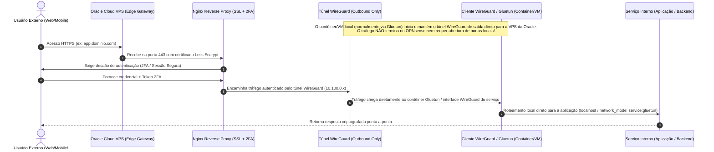

# Arquitetura de Ingress Seguro e Nuvem Híbrida

Este documento detalha o modelo de publicação de serviços na internet sem abertura de portas residenciais (Zero Inbound Port Forwarding), integrando instâncias públicas na Oracle Cloud Infrastructure (OCI) ao homelab local.

---

## 1. Fluxo de Publicação e Ingress Clientless

---

## 2. Princípios de Segurança Aplicados

### 1. Zero Inbound Ports na WAN Residencial & Isolamento por Contêiner
Em vez de expor o IP público dinâmico da residência com port-forwarding no roteador ou terminar o túnel no firewall OPNsense:
- A conexão WireGuard é originada de dentro da rede local diretamente pelos contêineres e VMs que necessitam de exposição pública (usualmente encapsulado via contêiner VPN **Gluetun** como sidecar de rede).
- O firewall perimetral OPNsense apenas atua como roteador transparente de tráfego de saída (outbound UDP), sem intermediar nem decodificar o Ingress.
- Políticas de `DROP` irrestritas são mantidas para conexões inbound da WAN na rede residencial.

### 2. Autenticação e Proxy Reverso com Defesa em Camadas
- **Nginx Reverse Proxy**: Gerencia terminação TLS com certificados modernos, cifras seguras e cabeçalhos de proteção (`HSTS`, `X-Content-Type-Options: nosniff`, `X-Frame-Options: SAMEORIGIN`).
- **Autenticação em Dois Fatores (2FA)**: Interfaces administrativas críticas (como o painel do servidor Minecraft ou consoles de gerenciamento) possuem camada obrigatória de autenticação multifator antes de qualquer exposição de backend.

### 3. Hardening e Privilégios Mínimos em Contêineres
- Ativação do parâmetro `no-new-privileges: true` em todos os contêineres gerenciados.
- Execução com usuários não-root mapeados (`PUID/PGID: 1000:1000`).
- Sistemas de arquivos de configuração montados como Read-Only (`:ro`) onde a escrita não é estritamente mandatória.
- Limites rigorosos de recursos declarados (`deploy.resources.limits` para CPU e RAM) para prevenir degradação por esgotamento de recursos (*noisy neighbors*).
