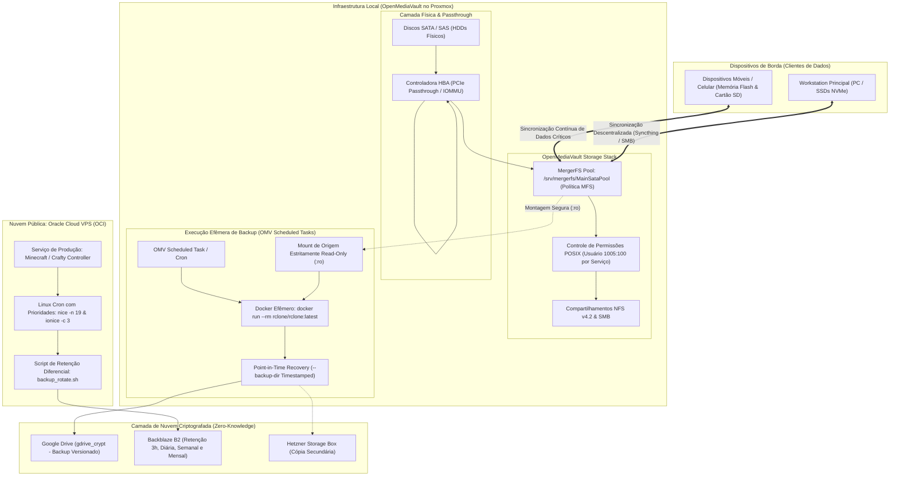

# Arquitetura de Armazenamento, Sincronização e Estratégia de Backup

Este documento aborda a topologia de persistência, controle de acesso granular a dados, agregação com MergerFS, sincronização entre múltiplos dispositivos (estações, celulares e cartões SD) e a execução conteinerizada de rotinas de backup criptografadas com versionamento e retenção inteligente.

---

## 1. Topologia Completa de Armazenamento e Backups



---

## 2. Persistência de Dados & Agregação com MergerFS

### Passthrough de HBA (Direct Storage Access)
Para garantir máximo desempenho, suporte a comandos S.M.A.R.T. diretos e integridade de escrita de baixo nível, a controladora **HBA SAS/SATA** é atribuída à VM do OpenMediaVault via **PCIe Passthrough (IOMMU)**. Isso elimina qualquer camada de abstração ou emulação de disco do hipervisor Proxmox.

### Agregação Heterogênea com MergerFS
Em vez de utilizar arranjos de RAID tradicional (que exigem discos de capacidades idênticas e impõem operações de *re-silvering* de alto risco de quebra), o ambiente adota o **MergerFS**:
- **Heterogeneidade de Mídia**: Discos de diferentes capacidades e fabricantes são combinados em um ponto de montagem unificado (`/srv/mergerfs/MainSataPool`).
- **Tolerância a Falhas Sem Risco em Cascata**: Cada disco mantém seu sistema de arquivos padrão (ext4/xfs). Se um disco físico falhar, apenas os arquivos nele residentes são perdidos (sendo restaurados a partir dos backups em nuvem), sem comprometer os demais membros do pool.
- **Política de Balanceamento**: Configurado com a diretiva `mfs` (*Most Free Space*), distribuindo gravações de novos arquivos dinamicamente no disco com maior capacidade livre.

### Barramento de Rede Isolado para Armazenamento (`nfs_isolat`)
Os compartilhamentos NFS v4.2 destinados aos nós de computação (como a MicroVM do Media Server com aceleração por GPU) operam sobre a bridge interna `nfs_isolat`:
- Bridge sem IP de gateway, sem servidor DHCP e sem DNS.
- Tráfego direto e sem roteamento entre a VM de armazenamento e os consumidores, blindando o barramento contra inspeção ou varreduras de rede externas.

---

## 3. Modelo 3-2-1 com Mídias Distintas e Sincronização Contínua

O princípio de proteção de dados respeita rigorosamente a regra 3-2-1 adaptada ao ecossistema moderno:

1. **3 Cópias de Dados Críticos**:
   - Cópia primária local no pool MergerFS.
   - Cópia ativa distribuída nos dispositivos de borda (estações de trabalho e celulares).
   - Cópias secundárias e terciárias em nuvem de objetos criptografada.
2. **2 Mídias Físicas Distintas**:
   - Mídia magnética/rotacional mecânica e flash local (HDDs no servidor e memórias flash/cartões SD em celulares e SSDs NVMe no PC).
   - Mídia em nuvem distribuída geograficamente (Cloud Object Storage).
3. **1 Cópia Off-site Criptografada e com Versionamento Temporal**:
   - Criptografia ponta a ponta com chaves do lado do cliente (`rclone crypt`). Os provedores em nuvem armazenam apenas blobs binários cifrados com AES-256.

---

## 4. Engenharia de Backup no OpenMediaVault (Rclone via Docker Efêmero)

Em vez de instalar binários, clientes de nuvem ou dependências no sistema operacional hospedeiro, os backups são executados como **contêineres Docker efêmeros** disparados pelas tarefas agendadas (*Scheduled Tasks*) do OpenMediaVault:

```bash
#!/bin/bash
# Execução conteinerizada efêmera via Docker gerenciada pelo OMV
TIMESTAMP=$(date +%Y-%m-%d_%H-%M)

docker run --rm \
  --user "1005:100" \
  -v /docker_appdata/rclone/config:/config \
  -v /docker_appdata/rclone/cache/cache:/cache \
  -v /srv/mergerfs/MainSataPool:/data:ro \
  -e TZ=America/Sao_Paulo \
  -e RCLONE_CONFIG=/config/rclone.conf \
  -e RCLONE_CACHE_DIR=/cache \
  rclone/rclone:latest sync /data/MSataPDataPool/data/media/music/music gdrive_crypt:backup/data/media/music/music \
  --backup-dir "gdrive_crypt:backup/data/media/music/music-versions/${TIMESTAMP}" \
  --fast-list \
  --drive-chunk-size 64M \
  --drive-stop-on-upload-limit \
  --transfers 4 \
  --checkers 8 \
  --tpslimit 10 \
  --bwlimit 30M \
  -v 2>&1 | tail -n 20
```

### Decisões Arquiteturais e Otimizações de Engenharia:
- **Segurança & Menor Privilégio (*Least Privilege*)**: O contêiner roda sob UID/GID não-root restrito (`--user "1005:100"`) e mapeia o pool de armazenamento como **estritamente somente-leitura (`:ro`)**. Mesmo no cenário extremo de invasão ou erro interno do contêiner, é matematicamente impossível corromper ou deletar os dados da origem.
- **Proteção Contra Ransomware & Exclusão Acidental**: Utilização de `--backup-dir` associado a timestamps dinâmicos (`${TIMESTAMP}`). Em vez de apagar arquivos modificados ou deletados na nuvem, o rclone move os estados anteriores para pastas versionadas imutáveis, garantindo **Point-in-Time Recovery**.
- **Respeito aos Rate Limits e QoS de Rede**:
  - `--tpslimit 10`: Limita transações por segundo na API do Google Drive para evitar HTTP 429 (*Too Many Requests*).
  - `--drive-chunk-size 64M`: Otimização da relação de uso de memória RAM versus vazão de upload para streams contínuos.
  - `--bwlimit 30M`: Limita a largura de banda de saída a 30 MB/s, garantindo que o tráfego de backup não degrade a navegação nem cause *bufferbloat* na rede residencial.
  - `--drive-stop-on-upload-limit`: Previne tentativas excedentes caso o limite de cota diária de upload seja atingido.

---

## 5. Estratégia de Retenção Multi-Tier na Oracle Cloud VPS (Crafty Controller / Minecraft)

Na VPS de produção hospedada na **Oracle Cloud Infrastructure (OCI)**, backups do servidor público de Minecraft gerenciados pelo Crafty Controller são sincronizados para o **Backblaze B2** com um modelo de retenção diferencial (*Grandfather-Father-Son*):

### Política de Janelas de Retenção
| Granularidade | Frequência de Execução | Retenção Máxima (`MAX_KEEP`) | Janela de Histórico Coberta |
| :--- | :--- | :---: | :--- |
| **Horária (`3h`)** | A cada 3 horas (`00:30`, `03:30`, ...) | **8 snapshots** | Cobre as últimas 24 horas contínuas |
| **Diária (`daily`)** | Todos os dias às `07:45` | **4 snapshots** | Cobre os últimos 4 dias |
| **Semanal (`weekly`)** | Domingos às `05:30` | **4 snapshots** | Cobre 1 mês de histórico |
| **Mensal (`monthly`)** | 1º dia de cada mês às `07:55` | **3 snapshots** | Cobre o último trimestre |

### Otimização de Concorrência e Prioridades do Kernel Linux
Para garantir que as rotinas de backup não causem *lag* (*tick drops*) no servidor de jogos, os agendamentos no Crontab utilizam controles avançados de escalonamento do kernel:
```cron
# nice -n 19: Prioridade mínima de CPU (Minecraft tem precedência irrestrita)
# ionice -c 3: Prioridade de I/O em disco ociosa (só acessa disco quando o jogo não estiver gravando chunks)

30 */3 * * * nice -n 19 ionice -c 3 /bin/bash /opt/scripts/backup_rotate.sh 3h
45 7 * * *   nice -n 19 ionice -c 3 /bin/bash /opt/scripts/backup_rotate.sh daily
30 5 * * 0   nice -n 19 ionice -c 3 /bin/bash /opt/scripts/backup_rotate.sh weekly
55 7 1 * *   nice -n 19 ionice -c 3 /bin/bash /opt/scripts/backup_rotate.sh monthly
```

### Rotação Numérica Inteligente no Backblaze B2
O script [backup_rotate.sh](file:///home/user1/Projects/antigravity-test/devops-portfolio/automation/scripts/oracle-vps-backup-rotate.sh) realiza a limpeza de arquivos históricos excedentes diretamente no storage remoto, parseando os arquivos ordenados por data de modificação:
```bash
/usr/bin/rclone lsf "$DEST_ARCHIVE" \
    --config "$RCLONE_CONFIG_PATH" \
    --files-only \
    --format "tp" \
    --separator "|" | \
sort -r | \
tail -n +$((MAX_KEEP + 1)) | \
cut -d "|" -f 2 | \
while read -r FILENAME; do
    echo "[$TIPO] Deletando antigo: $FILENAME" >> "$LOG_FILE"
    /usr/bin/rclone delete "$DEST_ARCHIVE/$FILENAME" --config "$RCLONE_CONFIG_PATH" >> "$LOG_FILE" 2>&1
done
```
Esse mecanismo previne o acúmulo infinito de custos de armazenamento em nuvem enquanto assegura a disponibilidade estrita de pontos de restauração históricos.
