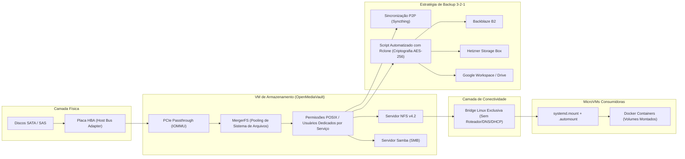

# Arquitetura de Armazenamento e Estratégia de Backup

Este documento aborda a arquitetura de persistência, controle de acesso a dados, agregação com MergerFS e o ciclo de vida de backups com rclone e Syncthing.

---

## 1. Topologia de Armazenamento e Fluxo de Dados

---

## 2. Princípios de Arquitetura

### Passthrough de HBA (Direct Storage Access)
Para garantir máximo desempenho, suporte a comandos SMART diretos e integridade de escrita, a controladora HBA é passada diretamente para a VM do OpenMediaVault via IOMMU (PCIe Passthrough), eliminando camadas de emulação de disco do hipervisor.

### Agregação de Armazenamento com MergerFS
Em vez de utilizar soluções de RAID tradicional que exigem discos idênticos e re-silvering de alto risco, o ambiente adota o **MergerFS**:
- **Heterogeneidade**: Permite unir discos de diferentes tamanhos em um único ponto de montagem unificado (`/srv/storage-pool`).
- **Resiliência a Falhas de Disco**: Se um disco físico falhar, apenas os arquivos residentes naquele disco específico são perdidos (podendo ser recuperados via backup), sem corromper o sistema de arquivos dos demais membros do pool.
- **Políticas de Escrita**: Configurado com a política `mfs` (*most free space*) para balanceamento uniforme de ocupação.

### Barramento de Rede Isolado para Armazenamento
Os compartilhamentos de alta vazão (NFS v4.2) entre a VM de armazenamento e as MicroVMs de computação trafegam por uma bridge Linux interna sem acesso à internet, sem gateway padrão e sem servidor DHCP:
- Reduz a superfície de ataque em 100% contra varreduras de rede externas.
- Elimina overhead de filtragem de pacotes e inspeção de firewall.
- Minimiza latência de I/O em rede para cargas como servidores de mídia e processamento de dados.

---

## 3. Estratégia de Backup 3-2-1

1. **3 Cópias de Dados Críticos**:
   - Cópia primária em execução nos discos locais (MergerFS).
   - Cópia de sincronização local em nós secundários via **Syncthing** para dados de alta volatilidade.
   - Cópia externa criptografada em nuvem.
2. **2 Mídias Distintas**:
   - Discos magnéticos/flash locais.
   - Armazenamento em nuvem de objetos (Cloud Object Storage).
3. **1 Cópia Off-site Imutável e Criptografada**:
   - Rotina automatizada disparada por timers do systemd (`rclone-backup.timer`).
   - Criptografia do lado do cliente com `rclone crypt` (arquivos e nomes de diretórios cifrados com chave assimétrica antes da saída pela WAN).
   - Sincronização distribuída entre múltiplos provedores: **Backblaze B2**, **Hetzner Storage Box** e **Google Drive**.
